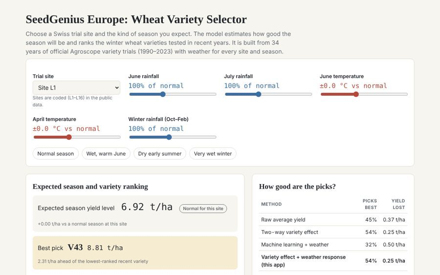
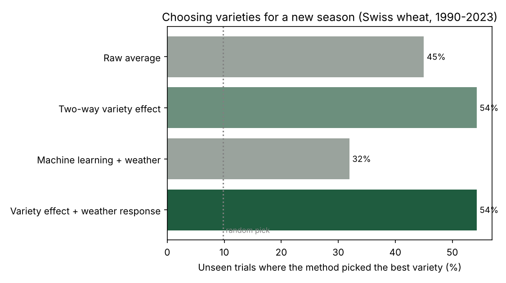
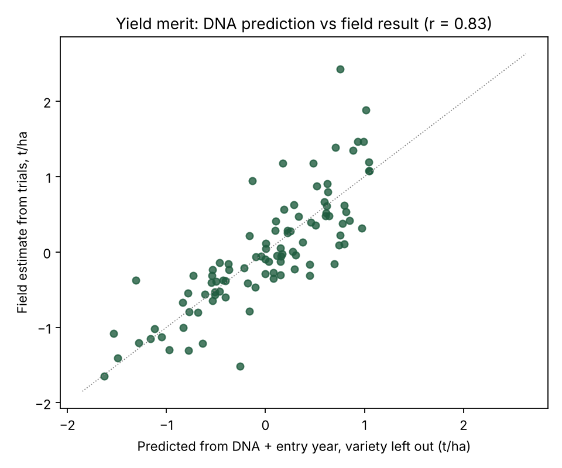
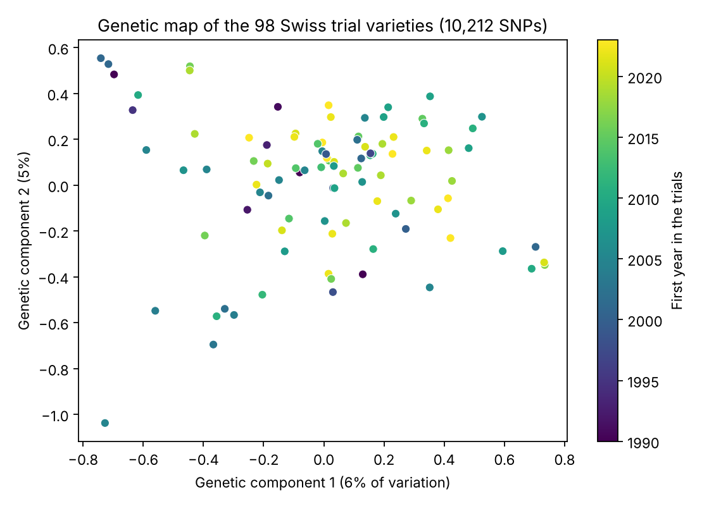

# SeedGenius Europe: Choosing Winter Wheat Varieties for the Next Season

**▶ Live app: [saphal-sharma.github.io/seedgenius](https://saphal-sharma.github.io/seedgenius/)**: pick a Swiss trial site and a season scenario, and see the expected season yield and the variety ranking.

> **Question:** Which winter wheat variety should be grown next season, and does the weather forecast change that choice?  
> **Answer:** A two-way variety model picks the best variety in 54% of unseen seasons (raw averages 45%, machine learning + weather 32%, random 10%). Weather sets the season's yield level; DNA markers plus entry year predict a variety's yield merit with r = 0.82.  
> **Method:** 34 years of Agroscope trials (303 trials, 98 varieties), leave-one-year-out validation, ridge weather model, calibrated Monte Carlo with the live ECMWF seasonal forecast, genomic prediction on 10,212 SNPs.




SeedGenius uses 34 years of official Swiss variety trials to answer a practical seed-industry question: **which variety should be grown next season, and how much does weather change that choice?** Every method is tested on seasons it has never seen, using decision metrics (how often it picks the winning variety) rather than only yield error.

## Data

Agroscope winter wheat trials under low-input management (no fungicides, insecticides or growth regulators), 1990–2023, with seasonal weather for every site and year:

- **3,880 variety × trial means** (3 replicates averaged) from **303 trials**, **98 varieties**, **16 sites**.
- **42 weather variables** per trial: monthly temperature (mean, min, max), rainfall, rain per wet day, dry days and solar radiation for March–July, plus winter rainfall.
- Varieties and sites are anonymised (V1–V98, L1–L16) in the public release.

SNP marker data come from the same record (`data/SNP_v1.0.0.csv`).

Source: Levy Häner L., Strebel S., Visse-Mansiaux M., Wuyts N., Herrera J.M., Pellet D. (2025). *Winter wheat performance data for varieties grown under low input conditions in Switzerland over the period 1990–2023.* Agroscope. Zenodo, [doi:10.5281/zenodo.16420898](https://doi.org/10.5281/zenodo.16420898). Licence CC BY 4.0. The files are in [`data/`](data/) unchanged.

## Method

1. **Two-way model:** yield = variety effect + trial effect, fitted with sparse least squares. This separates genetics from the luck of the site and season, which matters because varieties enter and leave the trial network in different years.
2. **Weather response:** Finlay–Wilkinson slopes (shrunk towards zero) measure whether a variety gains more or less than average in good seasons.
3. **Season quality from weather:** a ridge regression predicts each trial's yield level from standardised weather, site and year.
4. **Validation:** leave-one-year-out. Each season is predicted from models trained on the other 33 seasons only, which mimics choosing a variety before the season starts. 291 trials with at least four varieties were scored.
5. **Methods compared:** raw variety average, the two-way variety effect, a gradient-boosting model with weather (HistGradientBoosting), and the two-way effect plus each variety's weather response.

## Results

**Table 1.** Choosing a variety for unseen seasons (291 trials)

| Method | Picks the best variety | Yield lost vs best (t/ha) | Rank correlation within trial |
|---|---|---|---|
| Random pick | 9.8% | – | – |
| Raw variety average | 45.0% | 0.37 | 0.57 |
| Machine learning + weather | 32.0% | 0.50 | 0.51 |
| **Two-way variety effect** | **54.3%** | **0.25** | **0.66** |
| Two-way effect + weather response | 54.3% | 0.25 | 0.66 |



- **Good statistics beat a black box.** Estimating variety merit with a proper two-way model picks the winning variety in 54% of unseen trials, against 45% for raw averages and 32% for a machine-learning model with weather. The wrong pick costs 0.25 t/ha on average, a third less than with raw averages.
- **Weather sets the season, genetics sets the ranking.** Adding each variety's weather response did not change the choice. Variety rankings were stable across seasons, so the best recent variety is usually the best whatever the weather.
- **Weather explains part of the season yield level.** On unseen seasons, the ridge model explains 27% of the variation in trial yield level (typical error 0.72 t/ha; the seasons vary with SD 1.11 t/ha).
- **Wet, mild Junes hurt.** More dry days in June and July raise yield, while June rainfall and warm June nights lower it. In trials without fungicide this fits higher disease pressure (for example Septoria and rusts) during grain filling. Very wet winters also lower yield. The weakest season was 2016 (5.2 t/ha on average) and the best was 2022 (8.4 t/ha).


## Web app

[`docs/index.html`](docs/index.html) runs entirely in the browser. The user picks a site and adjusts June and July rainfall, June and April temperature and winter rainfall (dry days follow rainfall through regressions fitted on the trial data). The app then computes:

- **Season yield level** from the ridge model, starting from the site's median weather since 2004.
- **Predicted yield per variety** = season level + variety effect + slope × (season level − average season), for the 28 varieties tested since 2021 in at least 9 trials.

The JavaScript reproduces the Python predictions exactly (checked on trial L1 2023: 6.6896 t/ha in both).

## What if the summer is hotter? Probability testing

The app's second section tests about 2,000 possible seasons instead of one guess. It replays every past season at the chosen site (1990–2023), shifts all March–July temperatures by the chosen warming (0 to +3 °C) and June rainfall by a chosen factor, and adds the random variation observed in the trials:

- **Season variation** the weather model cannot explain (error on unseen seasons: 0.95 t/ha).
- **Variety-by-season variation** (residual SD 0.50 t/ha), plus estimation error for varieties tested in few trials.

For each variety it reports the chance of being the best, the expected yield, a bad year (10th percentile), a good year (90th percentile) and the chance of falling below a chosen minimum yield. It names the most likely winner and, when different, the safest variety (highest bad-year yield).

**Are the chances honest?** [`src/calibration.py`](src/calibration.py) tests them on seasons the model had not seen:

| Predicted chance of winning | Actual win rate | Cases |
|---|---|---|
| 1% | 1% | 2,517 |
| 7% | 7% | 474 |
| 15% | 13% | 368 |
| 24% | 23% | 153 |
| 39% | 42% | 142 |
| 60% | 72% | 104 |
| 84% | 74% | 23 |

In the model, +1 °C across March–July lowers the season yield level by about 0.3 t/ha (mainly through warmer June and July nights). Rankings hardly change with warming, because the varieties respond similarly to season quality. The model is linear and learned from 1990–2023, so it cannot capture sudden heat-stress damage beyond that range; the app warns when the warming goes far outside it.

### Using the live seasonal forecast

The button **"Use the latest ECMWF seasonal forecast"** replaces the sliders with the official ECMWF SEAS5 forecast, loaded live from the [Open-Meteo Seasonal API](https://open-meteo.com/en/docs/seasonal-forecast-api) (updated monthly on the 5th, 51 ensemble members, 7 months ahead). Each ensemble member becomes one possible season:

- **Temperature** for March–July = ECMWF's monthly anomaly (forecast minus the model's own hindcast climate) plus that member's deviation from the ensemble mean.
- **Rainfall** for March–July and winter (October–February) = the forecast as a ratio to the model's climate, again per member.
- Every member is combined with every past season at the site, giving about 3,400 simulated seasons.

Months beyond the 7-month range are treated as normal, and the app says which ones. In November, for example, June and July are not covered yet. The trial sites are anonymised, so the forecast is taken for one central point on the Swiss Plateau (near Bern). Seasonal forecasts for Central Europe have limited skill, which is why the app keeps all 51 members instead of only the average.

## DNA: relatives and genomic prediction

The same Agroscope record includes **12,106 SNP markers** for all 98 varieties ([`src/genomics.py`](src/genomics.py)). After removing rare markers (minor allele frequency below 5%), 10,212 remain. Markers are coded 0/1/2. Predictions use ridge regression on all markers (equivalent to GBLUP), always validated on varieties the model has not seen.

**Table 2.** Predicting a variety's yield merit (20 × 5-fold cross-validation across varieties)

| Prediction | r |
|---|---|
| Year of entry only (breeding-progress trend) | 0.69 |
| **Year of entry + DNA markers** | **0.82** |
| DNA markers, merit beyond the year trend | 0.62 |
| DNA markers, weather sensitivity | 0.15 |

**Table 3.** The realistic test: the model knows only varieties that entered the trials up to a year and ranks the ones that came later

| Model knows up to | New varieties | r, year only | r, year + DNA | Best quarter found, year only | with DNA |
|---|---|---|---|---|---|
| 2005 | 67 | 0.49 | 0.64 | 35% | 35% |
| 2008 | 59 | 0.47 | 0.64 | 40% | 40% |
| 2011 | 46 | 0.28 | 0.60 | 42% | 50% |
| 2014 | 40 | 0.24 | 0.61 | 30% | 50% |



- **DNA predicts yield potential before field testing.** Markers add clear information beyond breeding progress (r = 0.62 among varieties of the same era). For new varieties after 2011, the year + DNA model found half of the best quarter, against 30–42% with the year trend alone (25% by chance).
- **DNA does not predict weather sensitivity** (r = 0.15). How a variety reacts to good and bad seasons has to be measured in the field.
- **Sanity check:** V14 and V70 have identical marker profiles and almost the same field merit (−0.03 and −0.14 t/ha), which suggests the same or a reselected variety under two codes.
- **The app** shows, for any variety, its five closest relatives (share of identical markers), their yields, which are still in recent trials, and how its field result compares with its DNA prediction.



## Run it

```bash
pip install -r requirements.txt
python src/seedgenius_eu.py   # analysis, tables and charts in results/
python src/calibration.py     # checks the win probabilities
python src/genomics.py        # DNA markers: relatives and genomic prediction
python src/export_app.py      # rebuilds docs/index.html
```

## Limitations

- **Low-input trials only.** Results describe varieties without fungicide protection, which favours disease-resistant varieties. Rankings under intensive management may differ.
- **Anonymised varieties and sites** in the public data, so the app shows codes rather than variety names.
- **Seasonal weather only.** Daily weather would allow features such as heat days during flowering or rain at anthesis.
- **No uncertainty bands yet.** Conformal prediction intervals would show the risk of each choice.

## Earlier prototype

[`minnesota-demo/`](minnesota-demo/) holds the first version on historical Minnesota barley trials (1927–1936), with a SHAP-explained gradient-boosting model. Its app is at [saphal-sharma.github.io/seedgenius/minnesota](https://saphal-sharma.github.io/seedgenius/minnesota/).

**Author:** Saphal Sharma, M.Sc. student, Sustainable International Agriculture, University of Göttingen
