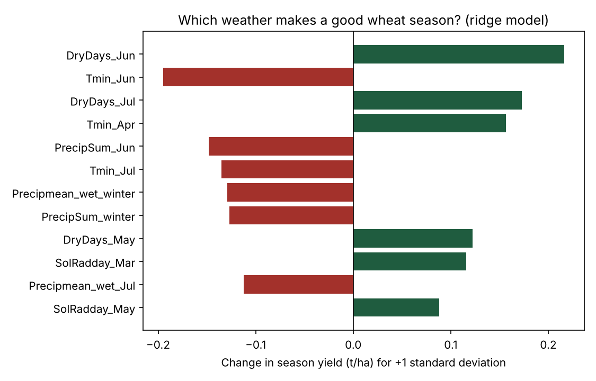

# SeedGenius Europe: Choosing Winter Wheat Varieties for the Next Season

**▶ Live app: [saphal-sharma.github.io/seedgenius](https://saphal-sharma.github.io/seedgenius/)**: pick a Swiss trial site and a season scenario, and see the expected season yield and the variety ranking.

SeedGenius uses 34 years of official Swiss variety trials to answer a practical seed-industry question: **which variety should be grown next season, and how much does weather change that choice?** Every method is tested on seasons it has never seen, using decision metrics (how often it picks the winning variety) rather than only yield error.

## Data

Agroscope winter wheat trials under low-input management (no fungicides, insecticides or growth regulators), 1990–2023, with seasonal weather for every site and year:

- **3,880 variety × trial means** (3 replicates averaged) from **303 trials**, **98 varieties**, **16 sites**.
- **42 weather variables** per trial: monthly temperature (mean, min, max), rainfall, rain per wet day, dry days and solar radiation for March–July, plus winter rainfall.
- Varieties and sites are anonymised (V1–V98, L1–L16) in the public release.

Source: Levy Häner L., Strebel S., Visse-Mansiaux M., Wuyts N., Herrera J.M., Pellet D. (2025). *Winter wheat performance data for varieties grown under low input conditions in Switzerland over the period 1990–2023.* Agroscope. Zenodo, [doi:10.5281/zenodo.16420898](https://doi.org/10.5281/zenodo.16420898). Licence CC BY 4.0. The files are in [`data/`](data/) unchanged.

## Method

1. **Two-way model:** yield = variety effect + trial effect, fitted with sparse least squares. This separates genetics from the luck of the site and season, which matters because varieties enter and leave the trial network in different years.
2. **Weather response:** Finlay–Wilkinson slopes (shrunk towards zero) measure whether a variety gains more or less than average in good seasons.
3. **Season quality from weather:** a ridge regression predicts each trial's yield level from standardised weather, site and year.
4. **Validation:** leave-one-year-out. Each season is predicted from models trained on the other 33 seasons only, which mimics choosing a variety before the season starts. 291 trials with at least four varieties were scored.
5. **Methods compared:** raw variety average, the two-way variety effect, a gradient-boosting model with weather (HistGradientBoosting), and the two-way effect plus each variety's weather response.

## Results

**Table 1.** Choosing a variety for unseen seasons (291 trials)

| Method | Picks the best variety | Yield lost vs best (t/ha) | Rank correlation within trial |
|---|---|---|---|
| Random pick | 9.8% | – | – |
| Raw variety average | 45.0% | 0.37 | 0.57 |
| Machine learning + weather | 32.0% | 0.50 | 0.51 |
| **Two-way variety effect** | **54.3%** | **0.25** | **0.66** |
| Two-way effect + weather response | 54.3% | 0.25 | 0.66 |


- **Good statistics beat a black box.** Estimating variety merit with a proper two-way model picks the winning variety in 54% of unseen trials, against 45% for raw averages and 32% for a machine-learning model with weather. The wrong pick costs 0.25 t/ha on average, a third less than with raw averages.
- **Weather sets the season, genetics sets the ranking.** Adding each variety's weather response did not change the choice. Variety rankings were stable across seasons, so the best recent variety is usually the best whatever the weather.
- **Weather explains part of the season yield level.** On unseen seasons, the ridge model explains 27% of the variation in trial yield level (typical error 0.72 t/ha; the seasons vary with SD 1.11 t/ha).
- **Wet, mild Junes hurt.** More dry days in June and July raise yield, while June rainfall and warm June nights lower it. In trials without fungicide this fits higher disease pressure (for example Septoria and rusts) during grain filling. Very wet winters also lower yield. The weakest season was 2016 (5.2 t/ha on average) and the best was 2022 (8.4 t/ha).



## Web app

[`docs/index.html`](docs/index.html) runs entirely in the browser. The user picks a site and adjusts June and July rainfall, June and April temperature and winter rainfall (dry days follow rainfall through regressions fitted on the trial data). The app then computes:

- **Season yield level** from the ridge model, starting from the site's median weather since 2004.
- **Predicted yield per variety** = season level + variety effect + slope × (season level − average season), for the 28 varieties tested since 2021 in at least 9 trials.

The JavaScript reproduces the Python predictions exactly (checked on trial L1 2023: 6.6896 t/ha in both).

## Run it

```bash
pip install -r requirements.txt
python src/seedgenius_eu.py   # analysis, tables and charts in results/
python src/export_app.py      # rebuilds docs/index.html
```

## Limitations

- **Low-input trials only.** Results describe varieties without fungicide protection, which favours disease-resistant varieties. Rankings under intensive management may differ.
- **Anonymised varieties and sites** in the public data, so the app shows codes rather than variety names.
- **Seasonal weather only.** Daily weather would allow features such as heat days during flowering or rain at anthesis.
- **No uncertainty bands yet.** Conformal prediction intervals would show the risk of each choice.

## Earlier prototype

[`minnesota-demo/`](minnesota-demo/) holds the first version on historical Minnesota barley trials (1927–1936), with a SHAP-explained gradient-boosting model. Its app is at [saphal-sharma.github.io/seedgenius/minnesota](https://saphal-sharma.github.io/seedgenius/minnesota/).

**Author:** Saphal Sharma, M.Sc. Sustainable International Agriculture, University of Göttingen
