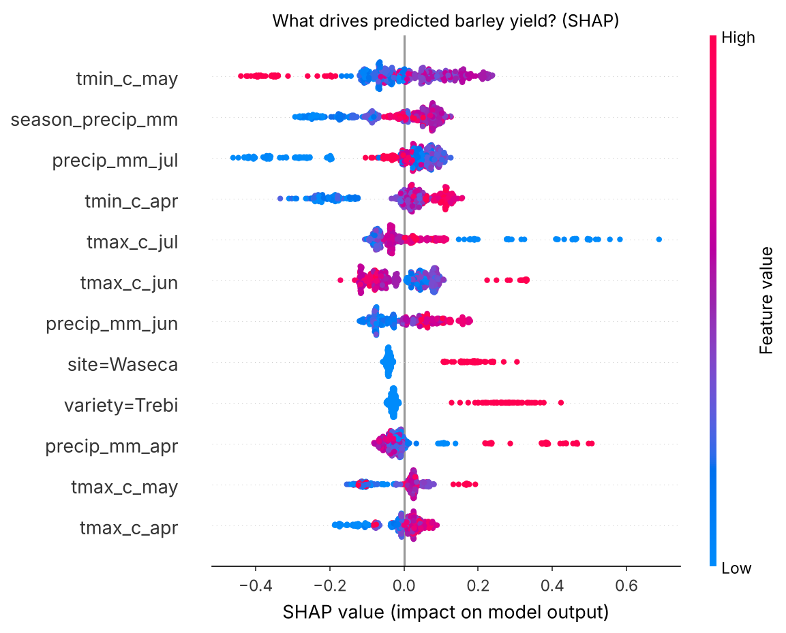
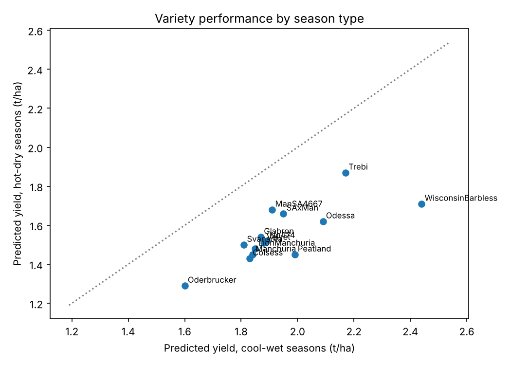

# SeedGenius Minnesota demo: historical barley trials (1927–1936)

> This was the first SeedGenius prototype. The main project now uses modern Swiss wheat trials; see the [main README](../README.md).

**▶ Demo app: [saphal-sharma.github.io/seedgenius/minnesota](https://saphal-sharma.github.io/seedgenius/minnesota/)**: pick a site and season and see the variety ranking.

SeedGenius predicts which crop varieties are likely to perform best in a given season. It combines historical variety trials with weather data, tests the predictions honestly on seasons the model has never seen, and explains them with SHAP values.

## The question

A seed company or farmer has to choose from many varieties before the season starts. Variety trials show average performance, but the best variety changes from year to year with the weather. Can weather information improve that choice, and which factors drive the predictions?

## Data

Real published data, distributed with the R package [agridat](https://github.com/kwstat/agridat):

- **Variety trials:** Minnesota barley trials, 1927–1936, at 6 sites. After keeping varieties with at least 20 trial records, the data cover 591 yields from 14 varieties in 57 site-years.
- **Weather:** monthly NOAA records for each site and year: precipitation and maximum and minimum temperature for April to July.
- **Site** stands in for soil and location, because the trials have no soil measurements.

Source: Wright, K. (2013). Revisiting Immer's barley data. *The American Statistician*, 67, 129–133.

## Method

1. **Features:** variety, site and 14 weather variables (monthly values, plus season totals and means).
2. **Validation:** leave-one-year-out cross-validation. Each season is predicted by a model trained only on the other nine years, which mimics choosing varieties before a new season.
3. **Models compared:**
   - Variety average yield.
   - Variety + site effects (additive, no weather).
   - Gradient boosting with weather features.
4. **Decision metrics:** beyond yield error, it measures how often the model picks the best variety in each trial, how much yield is lost when it picks wrong, and how well it ranks varieties within each trial.
5. **Explainability:** SHAP values (TreeExplainer) for the final model.

## Results

**Table 1.** Leave-one-year-out results (57 trials)

| Model | Picks the best variety | Yield lost vs best (t/ha) | Rank correlation within trial |
|---|---|---|---|
| Random pick | 9.8% | – | – |
| Variety average | 29.8% | 0.278 | 0.36 |
| Variety + site | 29.8% | 0.278 | 0.35 |
| **Gradient boosting + weather** | **38.6%** | **0.249** | **0.45** |

- **Weather improves variety choice.** The weather-aware model picked the best variety in 39% of unseen trials, compared with 30% for the usual "choose the variety with the best average" rule. The result held across random seeds (35–39%).
- **Absolute yield is still hard to predict.** For new seasons, R² stayed close to zero for all models. With only ten years of data, the overall level of a season cannot be forecast well, but the relative ranking of varieties can be improved. That ranking is what matters for the variety decision.
- **What drives predictions:** weather accounts for 75% of the model's explanation (mean absolute SHAP), variety for 17% and site for 8%. The most important single factors were May minimum temperature, season rainfall and July rainfall.



**Variety ranking by season type.** The model ranked varieties for hot-dry seasons (13 site-years) and cool-wet seasons (10 site-years):

- **Trebi** ranks 1st in hot-dry seasons and 2nd in cool-wet seasons, so it is a robust choice.
- **Wisconsin Barbless** ranks 1st in cool-wet seasons and 2nd in hot-dry seasons.
- **Peatland** shifts from 4th in cool-wet to 12th in hot-dry seasons, so it is best avoided where dry summers are likely.
- **Svansota** drops from 9th to 13th in cool-wet seasons.



## Run it

```bash
pip install numpy pandas scipy scikit-learn shap matplotlib
python minnesota-demo/src/seedgenius.py
```

## Web app

[`docs/minnesota/index.html`](../docs/minnesota/index.html) is an interactive variety selector: pick a trial site, set the season's rainfall and temperature, and see the predicted variety ranking update. It runs entirely in the browser using predictions precomputed by `src/export_app.py`, so it needs no server.

```bash
python minnesota-demo/src/export_app.py   # rebuilds docs/minnesota/index.html
```


## Limitations and next steps

- **Old varieties, small data:** historical varieties and only ten seasons. The same pipeline applies directly to modern trial networks (for example German Landessortenversuche) with many more site-years.
- **Weather detail:** monthly weather only. Daily weather would allow features such as heat days during flowering.
- **No soil data:** site is used as a proxy. Soil texture, pH and nutrient data would be natural additions.
- **No uncertainty yet:** predictions are point estimates. Quantile models or conformal prediction intervals would show the risk of each choice.

**Author:** Saphal Sharma, M.Sc. Sustainable International Agriculture, University of Göttingen
